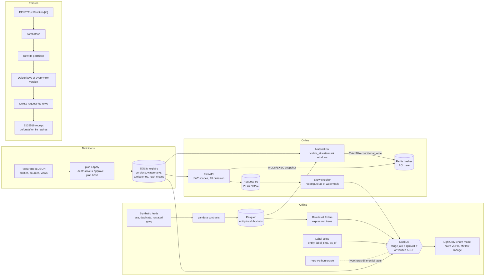

# point-in-time-feature-store

A small bitemporal feature store. Historical retrieval is checked against a brute-force oracle so
it cannot leak future data, online serving is checked for exact parity with offline
recomputation, and erasing an entity reaches every store and returns a signed receipt.

Python 3.12, DuckDB, Polars, pandera, Redis (fakeredis in tests), FastAPI, LightGBM, MLflow.
Everything in this README runs offline on a CPU-only laptop.

## Problem

Two of the most common silent ML bugs inflate offline metrics without failing anything:

- **Label leakage.** A training row gets a feature value that was not yet known at prediction
  time. A late-arriving cancellation, a restated payment, or simply joining today's feature table
  onto last year's labels does it.
- **Training-serving skew.** Features are computed one way offline and another way online, or the
  online copy is stale in ways nobody measured.

Feature stores also make the right to erasure hard, because copies of a person's data spread
across raw sources, online caches and request logs.

This repository treats all three as correctness properties with tests, not as conventions.

## Architecture



**Point-in-time retrieval.** For a spine row `(entity, label_time, as_of)` (by default
`as_of = label_time`) a source row is a candidate when `event_time <= as_of`,
`ingested_at <= as_of` and `event_time > label_time - TTL`. The chosen row maximizes
`(event_time, ingested_at, feature values)` with nulls smallest, a content-only tie-break that
does not depend on file order. The rules for ties, TTL boundaries, late data, clock skew and
staleness are in [docs/PIT_SEMANTICS.md](docs/PIT_SEMANTICS.md). The general path is a DuckDB
range join with `QUALIFY row_number() ... = 1`. Views that declare zero ingestion lag use an
`ASOF JOIN`, but only after the data is checked for lagged rows; if any exist, retrieval raises a
contract error instead of leaking.

**Definitions.** Entities, sources and feature views are pydantic models. A transformation is a
JSON expression tree over a closed node set (arithmetic, comparisons, casts, null handling,
`when`, literal string matching), compiled to Polars; there is no user SQL and no aggregation, so
a value can only depend on its own row. Views are versioned by a hash of their normalized
definition. `pitfs plan` diffs definitions against the registry; destructive or security-relevant
changes (removing or redefining a feature, changing TTL or lag declaration, removing a PII tag,
loosening a contract) need `--approve` with the exact plan hash, and every apply is appended to a
hash-chained change log.

**Online store and parity.** Materialization reads rows whose `max(event_time, ingested_at)` lies
in `(previous watermark, new watermark]`, keeps the greatest row per entity and writes it through
a registered Lua script that only replaces a stored row with a greater key. Reruns, overlaps and
out-of-order batches therefore converge to the same state. Reads use `MULTI/EXEC` and log the
committed and in-flight watermarks with the served values; the skew checker recomputes each
logged read offline as of that watermark and must match exactly.

**Erasure.** Sources are partitioned by a hash of the entity id, so erasure rewrites one bucket per
source. Keys of every view version ever applied are deleted, as are request-log rows. Tombstones
keep the entity out of later appends, materializations and request logging, and the receipt is
signed with Ed25519.

Layout:

```text
src/point_in_time_feature_store/
  dsl.py definitions.py registry.py hashchain.py sqlbuild.py        definitions and registry
  offline/ store.py features.py retrieval.py oracle.py baselines.py synthetic.py
  online/  store.py materialize.py acl.py
  serving/ auth.py service.py api.py request_log.py
  parity.py erasure.py training.py monitoring.py catalog.py demo.py cli.py
  core/ (settings, redacting logs, tracing, metrics, hardened app)   ml/ (contracts, drift, manifest)
tests/unit  tests/integration  bench/bench_baseline.py  docs/  FEATURE_CATALOG.md
```

## Quickstart

Requirements: [uv](https://docs.astral.sh/uv/) and Python 3.12.

```bash
uv sync --frozen
uv run python tasks.py demo    # end-to-end offline demo, JSON summary on stdout
uv run python tasks.py check   # ruff, mypy --strict, pytest + coverage, bandit, pip-audit, baseline
uv run python tasks.py bench   # evaluation benchmarks with regression thresholds
```

On Windows with a small repository drive, keep the environment elsewhere first:
`$env:UV_PROJECT_ENVIRONMENT = "C:/Users/<you>/.venvs/point-in-time-feature-store"`.

The demo applies the definitions (and shows a destructive change being refused), ingests
synthetic sources through the contracts in two knowledge-time phases, materializes incrementally
and checks the result against a one-shot run, trains the naive and point-in-time churn models with
MLflow lineage, serves through the API with different scopes, runs the skew checker, erases an
entity and verifies the receipt and the purge.

Definitions workflow:

```bash
uv run pitfs export-definitions --out var/definitions.json
uv run pitfs plan  --definitions var/definitions.json --registry var/registry.sqlite
uv run pitfs apply --definitions var/definitions.json --registry var/registry.sqlite --actor you
uv run pitfs catalog --out FEATURE_CATALOG.md
uv run pitfs verify-chains --registry var/registry.sqlite
```

Run the service against Redis (see `docker-compose.yml` for the full stack):

```bash
uv run pitfs generate-keys --out-dir var/keys
export APP_REDIS_PASSWORD=... REDIS_ADMIN_PASSWORD=... APP_LOG_HMAC_KEY=...
uv run pitfs redis-acl --out var/redis/users.acl      # passwords appear only as SHA-256
docker compose up --build                              # Redis with ACL, script loader, API
uv run pitfs mint-token --private-key var/keys/jwt_private.pem --subject svc-scoring \
    --scope 'features:read:*'
curl -s -H "Authorization: Bearer <token>" -H "Content-Type: application/json" \
     -d '{"entity_ids": ["c000001"], "features": ["transaction_stats:*"]}' \
     http://127.0.0.1:8000/v1/features/online
```

Containers were not run while building this repository; the build, smoke test, trivy scan and
SBOM are verified in CI (`.github/workflows/ci.yml`, job `docker`).

## Results

Measured with `uv run python bench/bench_baseline.py --check` on 2026-09-13: Windows 10
(10.0.19045), 6 logical CPUs, Python 3.12.14, DuckDB limited to 2 threads and 1 GB. The run printed
"all benchmarks within thresholds"; CI runs the same command against `bench/thresholds.json`.
Values are copied from that run's output. They are single-machine numbers for spotting
regressions, not performance claims.

**As-of correctness** is established by tests rather than timing: both retrieval paths equal the
oracle on hypothesis histories (60 examples per property with the default profile, 200 with
`HYPOTHESIS_PROFILE=ci`; the online materialization property is capped at 30) and on the synthetic
data, and the mutation test fails for event-time-only and naive joins (see [CLAIMS.md](CLAIMS.md)).

**Leakage demo** (`leakage_5_seeds`; 5 seeds, 10,000 customers each, mean holdout 7,064 rows;
gap = offline AUC - holdout AUC; details in [MODEL_CARD.md](MODEL_CARD.md)):

| Join used for training features | Offline AUC | Holdout AUC | Gap (mean of 5) | Gap range |
|---|---:|---:|---:|---|
| naive latest value | 1.0 | 0.4859 | **0.5141** | 0.4355 to 0.6595 |
| ASOF on event time only | 0.8072 | 0.8089 | -0.0017 | -0.0026 to -0.0001 |
| point-in-time (this store) | 0.8001 | 0.8080 | **-0.0079** | -0.0144 to -0.0058 |

The spec's targets (naive gap >= 0.05, point-in-time gap <= 0.01) hold. The event-time-only join
leaks little on this data because most ingestion lag is hours while labels look 30 days ahead; the
property tests, not this experiment, are what show it is wrong.

**Parity** (`parity_10k_requests`): 10,000 online requests over 3,000 customers, served across
four incremental materializations with late data in between (1,000 of the logged reads taken
while a materialization was in flight); 30,000 logged reads rechecked offline in 1.355 s:
**0 mismatches**.

**Idempotency** (`materialization_idempotency`):

| Run over 1,023,768 source rows, 3 views, into fakeredis | Time | Store digest |
|---|---:|---|
| 4 incremental runs (day 100, 200, 300, horizon) | 40.933 s | reference |
| 1 one-shot run to the horizon | 17.407 s | identical to reference |
| 4 runs again with a 500-day overlap over the same store | 42.522 s | identical to reference |
**Online latency** (`online_get_50_features`): one read of 50 features across 5 views through the
service layer (permission planning, `MULTI/EXEC` snapshot read, decoding, freshness), 5,000 reads
against **fakeredis in-process** (no network): p50 1.715 ms, p95 3.0 ms, **p99 3.495 ms**
(target < 10 ms). The access-audit write and HTTP handling are not included. CI repeats the
benchmark against a Redis service container.

**Historical retrieval on 1M rows** (`retrieval_1m_rows`): 1,036,748 source rows (generated in
1.039 s, validated and written in 1.369 s); every feature of the three views for a random
200,000-row spine in **1.621 s** (123,381 spine rows/s). DuckDB planned the range join as
`HASH_JOIN`. For `session_stats` the ASOF fast path took 0.242 s and the range join 0.104 s, with
identical results. The first benchmark run measured 38.75 s for the ASOF path because DuckDB had
planned a nested loop; the engine now forces the `ASOF_JOIN` plan (see ADR 0003).

## Security

Threats, controls and tests are in [docs/THREAT_MODEL.md](docs/THREAT_MODEL.md); every claim here
links to evidence in [CLAIMS.md](CLAIMS.md).

- **Authentication and scopes.** Callers present EdDSA JWTs verified with the issuer's public key
  (algorithm pinned; `exp`, `iat`, `iss`, `aud`, `sub` required). Reading a view needs
  `features:read:<view>`; PII-tagged features need `pii:read` and are otherwise omitted and listed;
  erasure needs `entities:erase`. `/metrics` uses a separate API key.
- **No user SQL.** Transformations are a bounded, closed expression tree; SQL identifiers pass a
  strict validator and all values are bound parameters; DuckDB runs with external access disabled
  and a locked configuration; semgrep bans formatted SQL. Features derived from PII columns must
  carry the PII tag.
- **Redis least privilege.** The application ACL user has only the commands the store uses on
  `fs:v1:*` keys (no `FLUSHALL`, `CONFIG`, `EVAL`, `SCRIPT LOAD`, `KEYS`). Scripts are loaded by an
  admin connection at deploy time and called by SHA from a code allowlist; writes fail closed when
  scripts are missing. Passwords come from the environment.
- **Input limits.** Entity keys are validated against fixed presets, batch and feature counts are
  capped, bodies are size-limited, and rate limits apply per verified JWT subject.
- **Privacy.** Entity ids appear in logs only as HMAC-SHA256; PII values are stored in the request
  log only as keyed HMACs; erasure receipts carry the HMAC, never the id. Purge verification checks
  Parquet, Redis, the request log and captured logs.
- **Integrity and audit.** Registry changes and every online read are appended to hash-chained
  tables; erasure receipts are Ed25519-signed; contract failures block materialization.
- **Supply chain and runtime.** uv.lock with hashes, pip-audit, bandit, semgrep, gitleaks,
  hadolint, trivy and a CycloneDX SBOM in CI; digest-pinned base images; non-root, read-only
  containers with all capabilities dropped. See [SECURITY.md](SECURITY.md) for reporting.

## Non-goals

- **Scale.** Single-node DuckDB and one Redis; no distributed query engine, sharding or
  multi-region replication. Correctness first.
- **Windowed aggregations and streaming.** Transformations are row-level by design (they cannot
  look at other rows). Rolling counts arrive precomputed from upstream, as in the synthetic data;
  there is no streaming ingestion or on-demand transformation at request time.
- **IEJoin.** The spec asked for a DuckDB IEJoin range join. With an equality on `entity_id` plus
  range predicates, DuckDB plans a `HASH_JOIN` with the inequalities as join conditions; the
  benchmark reports the operator it actually used.
- **MLflow tracking server.** Lineage uses MLflow's file store, which MLflow 3 keeps in maintenance
  mode behind `MLFLOW_ALLOW_FILE_STORE=true` (set by the training code); lineage is duplicated in
  the registry's `training_runs` table.
- **Machine unlearning and external copies.** Erasure removes data from the store's own sources,
  online keys and request log. Models trained before erasure are not retrained, and backups or
  datasets exported by users are out of scope. Erasure rewrites history on purpose, so a training
  set that contained the entity cannot be rebuilt bit-for-bit.
- **Token lifecycle.** No token revocation or key rotation workflow; the service trusts one issuer
  public key.
- **Redis key expiry.** TTLs are enforced when reading (against request time), not by Redis
  expiry, so expired rows stay in memory until overwritten or erased.
- **ACL enforcement in local tests.** fakeredis does not enforce ACLs; the ACL is validated
  statically locally and enforced against a real Redis only in CI. The online latency benchmark
  uses fakeredis locally and a Redis service container in CI.
- **Scheduling.** Materialization, skew checks and drift checks are commands and library calls;
  there is no scheduler or alerting.
- **Metric naming.** The spec's `materialization_lag` is exported as
  `materialization_lag_seconds` (Prometheus unit suffix).
- **Local containers.** `docker compose` was not run while building this repository.

## Documentation

- [docs/PIT_SEMANTICS.md](docs/PIT_SEMANTICS.md): the retrieval specification (TTL, ties, late data, staleness)
- [docs/THREAT_MODEL.md](docs/THREAT_MODEL.md), [SECURITY.md](SECURITY.md), [CLAIMS.md](CLAIMS.md)
- [MODEL_CARD.md](MODEL_CARD.md): the churn model used in the leakage experiment
- [FEATURE_CATALOG.md](FEATURE_CATALOG.md): generated from the definitions
- [docs/adr/](docs/adr/): design decisions (bitemporal tie-break, range join vs ASOF, Lua writes and
  watermarks, partitioning and erasure)
