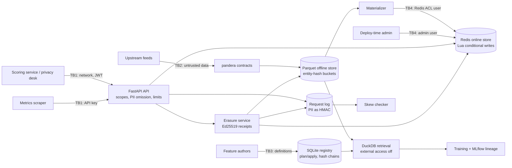

# Threat model

Method: STRIDE per trust boundary. Each row maps a threat to the control that addresses it and to
the test, bench script or CI job that shows the control works. `scripts/check_baseline.py`
verifies that every backticked evidence reference exists.

The system is a feature store. Its assets are the **correctness of training data** (no label
leakage), the **consistency of served features** with training (no skew), **personal data** in
sources, features, online rows and logs, the **ability to erase** a person everywhere, and the
**integrity of definitions and audit evidence**.

## System and trust boundaries

Assumptions: TLS terminates in front of the service; the token issuer's private key and the
receipt signing key are managed outside the service container (only the JWT public key and the
receipt private key path are configured); the host, container runtime and filesystem are trusted;
feature authors are authenticated by the repository workflow that runs `pitfs apply`; at most one
materializer runs per feature view at a time (runs of different views may overlap).

## STRIDE table

| ID | STRIDE | Threat | Entry point / asset | Control | Test / evidence | Residual risk |
|---|---|---|---|---|---|---|
| S1 | Spoofing | Caller forges, replays or downgrades a token (`alg: none`, HMAC confusion, other key, expired, wrong audience), or holds a long-lived token that can never be withdrawn | TB1, feature routes | EdDSA-only JWT verification with the issuer's public key; `exp`, `iat`, `iss`, `aud`, `sub` required; `exp - iat` must be positive and at most `APP_JWT_MAX_TOKEN_LIFETIME_SECONDS` (default one hour); `iat` in the future beyond the leeway refused; scope and subject formats validated; uniform 401 | `tests/unit/test_auth.py::test_algorithm_confusion_and_tampering_are_rejected`, `tests/unit/test_auth.py::test_invalid_tokens_are_rejected`, `tests/unit/test_auth.py::test_tokens_with_excessive_lifetimes_or_future_issue_times_are_rejected`, `tests/integration/test_api.py::test_feature_routes_require_a_valid_token` | No revocation list; a stolen token stays valid until its `exp`, at most the configured lifetime (`pitfs mint-token` defaults to 15 minutes) |
| S2 | Spoofing | Anyone scrapes `/metrics` | TB1, metrics | API-key digests compared in constant time; fails closed without keys | `tests/unit/test_security.py::test_every_configured_digest_is_compared_without_early_exit`, `tests/integration/test_api.py::test_metrics_expose_the_feature_store_families` | Operators may disable metrics auth |
| S3 | Spoofing | A process uses the passwordless default Redis user or the admin user | TB4, Redis | Default user off; application user with password (SHA-256 in the ACL file, secret from env); admin user only for script loading | `tests/unit/test_acl.py::test_validation_catches_every_privilege_widening`, `tests/unit/test_acl.py::test_real_redis_enforces_the_acl` (CI) | ACL enforcement is verified against real Redis in CI only; fakeredis ignores ACLs |
| T1 | Tampering | Label leakage: training rows get feature values not yet known at label time (late, restated, duplicated or out-of-order data) | Training data | Bitemporal candidate rule and content-based ordering; both DuckDB paths differential-tested against an oracle; mutation test proves the property catches event-time-only joins | `tests/unit/test_pit_properties.py::test_range_join_equals_the_oracle`, `tests/unit/test_pit_properties.py::test_no_value_derives_from_a_row_unknown_at_label_time`, `tests/unit/test_pit_properties.py::test_known_wrong_joins_fail_the_oracle_property`, `tests/integration/test_offline_retrieval.py::test_retrieval_on_generated_data_matches_the_oracle`, `bench/bench_baseline.py` | Leakage through features computed upstream (outside the store) is not detectable here |
| T2 | Tampering | A view falsely declares zero ingestion lag, so the ASOF fast path would leak | Definitions, retrieval | Lag verified against the data before every ASOF join; violation raises a contract error | `tests/unit/test_pit_properties.py::test_asof_path_rejects_lagged_data_instead_of_leaking`, `tests/integration/test_offline_retrieval.py::test_a_false_zero_lag_declaration_is_rejected` | None known |
| T3 | Tampering | Malformed, skewed, backfilled or late-stamped rows enter the offline store or the online store, including rows appended while a materialization is running | TB2, sources | pandera contracts (types, bounds, allowed values, NaN, clock skew, max backfill); rows at or below a committed watermark or a running materialization's target rejected (runs record their target under the offline store lock before scanning, and appends check the floor under the same lock, so no row slips between a scan and its commit); a failed run releases its target; contract failures block materialization and leave the watermark unchanged | `tests/unit/test_ml_contracts.py::test_clock_skew_beyond_the_tolerance_is_rejected`, `tests/unit/test_ml_contracts.py::test_rows_behind_the_materialization_watermark_are_rejected`, `tests/integration/test_materialize_parity.py::test_contract_failures_block_materialization_and_keep_the_watermark`, `tests/integration/test_materialize_parity.py::test_rows_behind_the_watermark_are_rejected_on_ingest`, `tests/integration/test_materialize_parity.py::test_appends_during_an_inflight_materialization_are_refused_not_lost`, `tests/integration/test_materialize_parity.py::test_a_failed_materialization_releases_its_knowledge_floor` | Values that satisfy the contract but are wrong upstream pass; one materializer per view at a time is assumed, not enforced |
| T4 | Tampering | Online values drift from offline (training-serving skew), through bugs, partial runs or direct edits of Redis | Redis, serving | Idempotent, order-independent Lua writes; two-phase watermark with snapshot reads; skew checker recomputes logged reads exactly and reports mismatching feature names per view | `tests/unit/test_pit_properties.py::test_incremental_out_of_order_materialization_matches_offline_as_of_the_watermark`, `tests/integration/test_materialize_parity.py::test_tampered_online_values_are_reported_without_values`, `tests/integration/test_materialize_parity.py::test_reads_during_an_inflight_materialization_are_not_false_mismatches`, `bench/bench_baseline.py` | Detection is sampled (request log sample rate); an edit to an unsampled entity is not caught. The checker recomputes with the same transformation code that materialization uses, so it catches watermark, write-path, serving and direct-edit skew, but not two diverging implementations of one feature (there is only one; request-time transformations are a non-goal) |
| T5 | Tampering | Destructive or security-relevant definition change (feature removed or redefined, TTL changed, PII tag removed) applied without review | TB3, registry | Plan/apply diff; destructive plans need `--approve` plus the exact reviewed plan hash; approvals and rejections appended to the hash-chained change log | `tests/unit/test_registry.py::test_destructive_changes_need_approval_of_the_exact_plan`, `tests/integration/test_demos_cli.py::test_definition_workflow` | Whoever controls the registry file can bypass the CLI; the chain makes that evident, not impossible |
| T6 | Tampering | Change log or access audit edited, truncated or rebuilt from scratch | Registry | SHA-256 hash chain over canonical JSON detects in-place edits and reordering; `pitfs anchor-chains` signs every chain's length and head with an Ed25519 key held outside the database, and `pitfs verify-chains --anchor` detects truncation below, or any rewrite of, the anchored prefix (without an anchor the command warns that it cannot) | `tests/unit/test_registry.py::test_tampered_or_truncated_chains_are_detected`, `tests/unit/test_anchors.py::test_truncation_passes_the_bare_chain_check_but_not_the_signed_anchor`, `tests/unit/test_anchors.py::test_a_same_length_rewrite_is_detected`, `tests/unit/test_anchors.py::test_forged_or_foreign_anchors_are_rejected`, `tests/integration/test_demos_cli.py::test_chain_anchor_commands_detect_truncation` | Entries written after the latest anchor can be removed undetected, so anchors must be taken regularly and stored away from the registry host; compromise of the anchor key |
| T7 | Tampering | Forged or altered erasure receipt | Erasure evidence | Ed25519 signature over canonical JSON, key id checked | `tests/integration/test_erasure.py::test_receipts_detect_tampering_and_foreign_keys` | Receipt signing key compromise |
| T8 | Tampering | Compromised dependency, base image or CI action; unsafe model artifacts | Build, models | uv.lock, pip-audit, digest-pinned bases, trivy, SBOM; LightGBM text models, no pickle | `.github/workflows/ci.yml#pip-audit`, `.github/workflows/ci.yml#docker`, `tests/unit/test_no_pickle.py::test_source_tree_has_no_pickle_family_serialization` | Actions are tag-pinned until publication |
| R1 | Repudiation | Dispute over who read or tried to read which features, applied a change or requested an erasure | Registry | Access audit entry per authenticated online read attempt: granted (`online_read`: subject, views, entity count, HMAC digest of the batch, PII served) or refused with 403/422 (`online_read_denied` with the reason); refused erasures (`erase_denied`, entity HMAC); change log entries for applies and erasures | `tests/integration/test_api.py::test_access_is_audited_and_logs_carry_only_entity_hmacs`, `tests/integration/test_api.py::test_denied_reads_and_erasures_are_audited`, `tests/integration/test_erasure.py::test_erasure_removes_every_copy_and_signs_a_receipt` | Timestamps come from the service clock; requests without a valid token have no verified subject and are only counted (`auth_failures_total`); refusals of `GET /v1/views` are not audited |
| I1 | Information disclosure | PII-tagged features reach callers without `pii:read`, or a view is read without its scope | TB1 | Per-view scopes (403); PII features omitted and listed under `omitted` | `tests/integration/test_api.py::test_view_scopes_are_enforced_and_pii_is_omitted_without_its_scope` | Scopes are only as good as the issuer's policy |
| I2 | Information disclosure | PII laundered through a transformation (a feature derived from a PII column without the tag) | TB3 | Definitions refuse untagged features that reference PII columns | `tests/unit/test_definitions.py::test_features_derived_from_pii_columns_must_be_tagged` | Semantic PII in non-tagged columns is not detected |
| I3 | Information disclosure | Entity ids or PII in application logs, URLs logged by HTTP clients, or the request log | Logs, request log | HMAC-SHA256 of entity ids in logs; redaction processor; URL-logging client libraries held at WARNING; PII values stored in the request log as keyed HMACs | `tests/integration/test_api.py::test_access_is_audited_and_logs_carry_only_entity_hmacs`, `tests/unit/test_components.py::test_request_log_sampling_storage_and_erasure`, `tests/unit/test_logging.py::test_exception_tracebacks_are_redacted` | Reverse-proxy access logs in front of the service see `DELETE /v1/entities/{id}` paths |
| I4 | Information disclosure | Contract failures, validation errors or skew reports echo sensitive values | Errors, reports | Summaries carry column, check and count only; skew reports carry feature names; validation errors omit input | `tests/unit/test_ml_contracts.py::test_violations_are_summarized_without_the_offending_values`, `tests/integration/test_materialize_parity.py::test_tampered_online_values_are_reported_without_values`, `tests/integration/test_app.py::test_validation_errors_never_echo_submitted_values` | None known |
| I5 | Information disclosure | Residual personal data after erasure (Parquet, Redis under old view versions, request log rows and the bytes of its SQLite file, an append racing the erasure, re-ingestion, re-materialization) | All stores | Tombstone first; rewrite affected partitions; delete keys of every view version; delete request-log rows and scrub the SQLite file (`secure_delete`, WAL checkpoint with truncation, `VACUUM`); appends read tombstones under the store lock, so an append racing the erasure cannot write rows back; skip tombstoned entities in later materializations and request logging; purge verification queries every store and scans the raw bytes of the request-log and registry SQLite files and their WAL for the id | `tests/integration/test_erasure.py::test_erasure_removes_every_copy_and_signs_a_receipt`, `tests/integration/test_erasure.py::test_erased_entities_do_not_come_back`, `tests/integration/test_erasure.py::test_an_erasure_racing_an_append_does_not_resurrect_the_entity`, `tests/integration/test_erasure.py::test_purge_verification_scans_raw_storage_bytes`, `tests/unit/test_components.py::test_request_log_erasure_leaves_no_raw_bytes_on_disk`, `tests/integration/test_api.py::test_erasure_endpoint_requires_its_scope_and_returns_a_signed_receipt` | Trained models, backups and user-exported datasets are out of scope. Below SQLite and Parquet nothing is overwritten: replaced part files are unlinked, and journaling filesystems, SSD remapping and snapshots may keep old blocks; Redis replicas and persistence files are outside the store (the compose Redis runs without RDB or AOF) |
| I6 | Information disclosure | SQL injection or file reads through retrieval | Retrieval | No user SQL; transformations are a closed expression tree; identifiers validated; values bound; DuckDB external access disabled and configuration locked; semgrep bans formatted SQL | `tests/unit/test_dsl.py::test_disallowed_nodes_are_rejected_without_echoing_values`, `tests/unit/test_components.py::test_only_plain_identifiers_can_enter_sql_text`, `tests/integration/test_offline_retrieval.py::test_the_engine_has_no_external_access`, `tests/unit/test_components.py::test_source_never_interpolates_values_into_execute_calls`, `.github/workflows/ci.yml#semgrep` | DuckDB itself is trusted |
| D1 | Denial of service | Request floods or oversized batches | TB1 | Token bucket per verified JWT subject (address bucket otherwise); maximum entities and features per request; body size limit | `tests/integration/test_api.py::test_rate_limits_apply_per_verified_subject`, `tests/integration/test_api.py::test_requests_are_bounded_and_validated`, `tests/integration/test_app.py::test_body_size_limit_applies_to_declared_and_streamed_bodies` | In-process limiter only |
| D2 | Denial of service | Expensive definitions (deep or huge expression trees, regex backtracking in key validation) | TB3 | Node and depth limits; literal substring matching; entity keys validated with fixed presets | `tests/unit/test_dsl.py::test_trees_deeper_or_larger_than_the_limits_are_rejected`, `tests/unit/test_definitions.py::test_entity_key_presets` | Large spines are bounded by DuckDB's memory limit, not by the API |
| D3 | Denial of service | Redis restart empties the script cache; writes would fall back to unsafe paths | TB4 | No `EVAL` fallback: writes fail closed and `/readyz` reports `scripts: fail` | `tests/unit/test_online_store.py::test_only_registered_scripts_can_run_and_missing_scripts_fail_closed`, `tests/integration/test_api.py::test_probes_report_registry_redis_and_scripts` | Requires an operator to reload scripts |
| E1 | Elevation of privilege | Application credentials used to flush data, change configuration or run arbitrary Lua | TB4 | ACL: `-@all` plus an allowlist on `fs:v1:*`; no `EVAL`, `SCRIPT LOAD`, `FLUSHALL`, `CONFIG`, `KEYS`; client-side script allowlist; semgrep bans `eval` on Redis clients | `tests/unit/test_acl.py::test_rendered_acl_is_least_privilege`, `tests/unit/test_online_store.py::test_source_never_calls_eval_or_script_load_outside_the_loader`, `.github/workflows/ci.yml#test` | Application user can still overwrite rows under `fs:v1:*` (detected by T4) |
| E2 | Elevation of privilege | A reader erases entities or reads the registry | TB1 | Separate `entities:erase` and `registry:read` scopes | `tests/integration/test_api.py::test_erasure_endpoint_requires_its_scope_and_returns_a_signed_receipt`, `tests/integration/test_api.py::test_views_listing_needs_registry_scope_and_hides_transformations` | None known |
| E3 | Elevation of privilege | User-supplied code runs in the service (SQL, Python callables, pickled artifacts) | TB3 | Closed node allowlist compiled to Polars; no pickle-family I/O | `tests/unit/test_dsl.py::test_the_node_set_is_closed`, `tests/integration/test_check_baseline.py::test_pickle_family_serialization_in_source_fails` | None known |
| E4 | Elevation of privilege | Code execution inside a container escalates | Runtime | App image: non-root UID 10001, read-only root filesystem, all capabilities dropped, no-new-privileges. Compose Redis starts as the image's non-root `redis` user, so its entrypoint needs no capabilities; only the JWT public key and the receipt private key are mounted into the app containers. The compose stack is brought up and exercised in CI | `.github/workflows/ci.yml#docker`, `.github/workflows/ci.yml#compose` | Kernel or runtime vulnerabilities; containers were not run locally while building this repository, only in CI |

## Out of scope

Multi-tenant isolation, key management services, token revocation, backups, network attacks
below TLS, and denial of service beyond one process. See README Non-goals.
